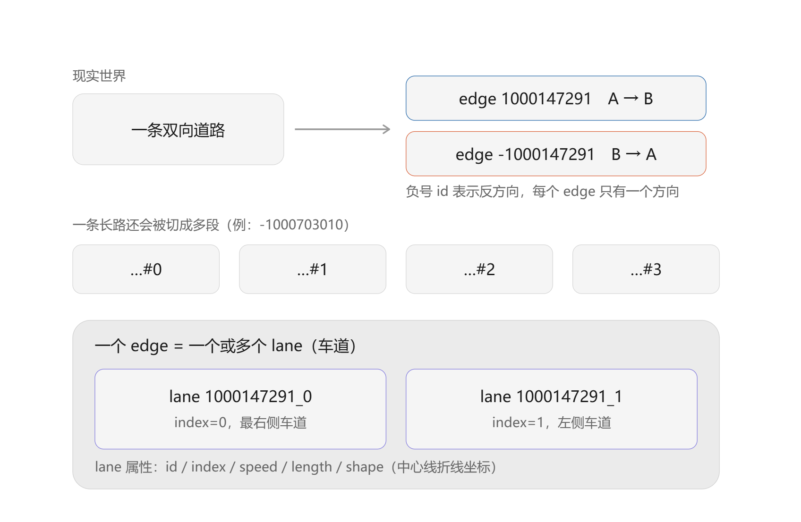
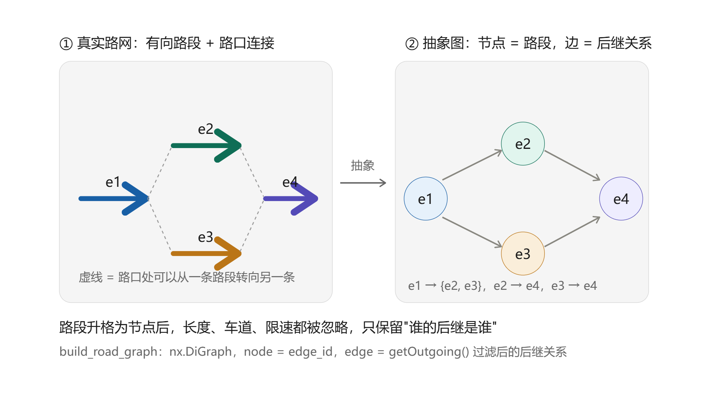
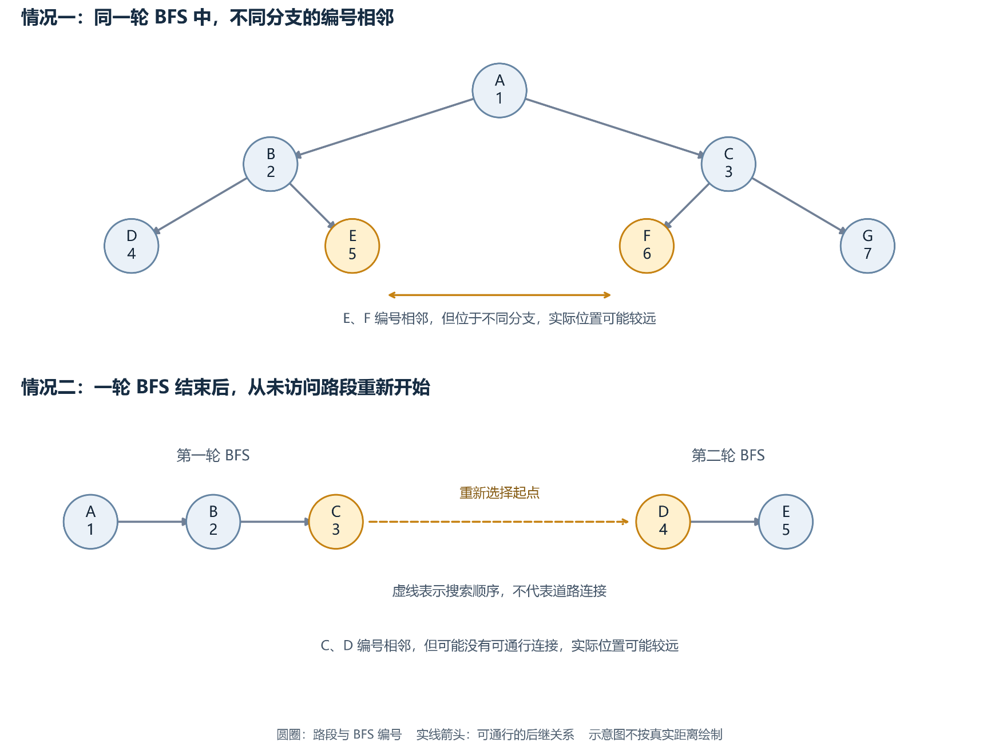
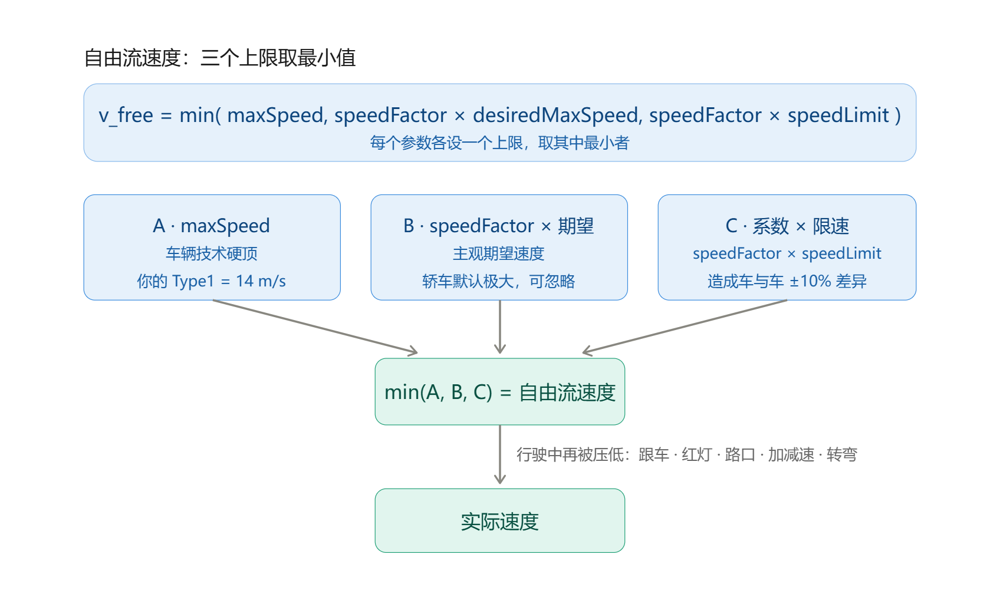

# SUMO路径生成说明

## 路网的读取与处理

路网选用北京四环（包括四环）的路网文件，北京四环范围：

（116.2649–116.4901°E 39.8275–39.9903°N）

[这是官方文档对路段、车道等的定义，](https://sumo.dlr.de/docs/Networks/SUMO_Road_Networks.html)路段在net文件中用<edge>标签表示，这里拿道路20261119（实际不存在，仅作示例）来举例，现实中的一条双向道路，假设从点A到点B的路段的edge ID为20261119，那么从B至A的edge ID为-20261119（包含负号！）。假设这条道路有多个路段，那么可以用#表示各个路段号如：20261119#0，20261119#1，-20261119#3等。一个路段中有多个车道，车道用lane属性表示，其id号可表示为20261119_0，-20261119#3_1。在原始路网中，也有部分路段的id表示包含下划线，这是internal路段，该路段讲解见下文。

除了路段id外，<edge>还包括from和to属性，分别指向路段起点和终点，priority表示路段有多重要，可用于路权的计算，本项目没有用到。type是路段的类型。<edge>标签下包含了下级标签<lane>，其包含的属性有index:车道号索引，从最右侧车道向左递增。allow:允许通过的车辆类型，disallow:不允许通过的车辆类型，speed:在该车道上允许的最大速度，length:车道的长度，shape:车道的形状，不重要，了解即可。

此项目中包含两个路网文件，此次使用的是Beijing_nointernal.net.xml，此文件是处理后的路网文件，原文件为Beijing_bbox_clipped.net.xml。处理方法是使用了netconvert命令，其中包含了--no-internal-links选项。这是官网上对该选项的解释。中文解释：设为 true 时路网不含交叉口内部车道，车辆"跃过"路口；为避免路线长度被系统性缩短，所有边长度被人为设为路口中心之间的距离。设为 false（默认）时，交叉口内部有车道，车辆像普通车道一样行驶，但受阻塞约束。

net文件中，学校公园内部的道路和普通道路采用相同的标签，在路网上去除较为繁琐困难。但通过下一步的筛选，可以筛出不允许客车通过的路段，如果是断头路等无法作为路径的起点，会在最终重新挑选起点。

实际运用时，可以通过edge.allows("passenger")来筛选允许客车通过的路段，总共有58932 条路段。这是官方文档中对车辆类型的定义，我们的项目中只有passenger一种车辆，筛选的路段也只支持passenger通过。

为了下一步对路段的排序，先把路网用图来表示，我们采用的是有向图，调用的是python的networkx包。建图时，路段（含方向）作为一个节点，路段的联通关系作为有向边。一条双向路段对应的是两个节点（因为在路网文件中，单个edge标签对应的是单个有向路段），如下图：

## 路段的排序

路网中的道路编号的先后顺序没有规则，要建立路径起点的混合高斯分布，即让车辆行驶的起点集中在若干范围内，需要先给路段一个编号，这里采用的是广度优先搜索算法（BFS），相近路段的编号基本相差较小（可能有些会有较大偏差，有两个原因，一个原因是同一轮 BFS 中，不同分支的路段编号可能相近，但实际位置较远。一个原因是一轮 BFS 结束后，需要重新选取起点）。但目前没有较好的方法来解决这个问题。

给路段分配排序号时，建立{edgeID:edge对象}字典，通过sumolib中的getOutgoing()方法获取路段的后续连接路段，建立{edgeID:[后续edgeID]}，调用networkx包，把路径作为图中的点，路径之间的联通关系作为有向边。[这里是networkx相关函数的使用方法](https://networkx.org/documentation/networkx-3.6.1/tutorial.html)。通过BFS广度优先搜索算法依次遍历路径图，给各个路径一个新的编号（rank）。

## 路径起点的确定

路径起点的选取有三种模式：工作日、周末、突发模式，起点的分布需要满足混合高斯分布。以工作日为基础模式，周末和突发模式在工作日模式的基础上替换部分高斯分量。高斯分量是起点分布中的一个组成部分，用于确定选取的起点路段编号范围。

先根据路段的属性确定原始权重。将路段长度、车道数量和后继路段数量相乘，作为该路段的 score。这里代码统计的是后继路段数量，车道数量采用路段的总车道数。

工作日模式使用 rng.choices() 按权重逐次抽取50个不同路段作为高斯分量的中心。每次选取后，将该路段移出候选列表，实现不放回抽样；在剩余候选路段中，权重越大，被选中的概率越高。选取完成后，以各中心路段的排序号作为分量均值，并将对应路段的原始权重归一化，确定各分量在混合高斯分布中的占比。

将选中的50个中心的原始权重相加，每个分量的原始权重除以这个总和，得到归一化后的分量权重，50个分量权重之和为1。分量均值取中心路段的 rank。令 R 为本次参与排序的路段总数，d = R/10，工作日各分量的标准差为0.4d，方差为这个标准差的平方。

周末模式随机从工作日的50个中心中选出25个替换，保留另外25个。替换进来的25个新中心不能属于工作日中心集合。保留分量沿用原标准差，新分量的标准差在0.36d到0.44d之间均匀抽取，方差取其平方。组成周末模式后，再按这50个中心的原始权重重新归一化。

突发模式随机替换工作日模式中的30%，即15个中心，保留35个。新增的15个中心既不能属于工作日中心集合，也不能属于周末中心集合。新增分量的标准差在0.1d到0.8d之间均匀抽取，方差取其平方；保留分量沿用原标准差，最后重新归一化权重。因为三种模式需要50、25和15个不同的新中心，正权重候选路段至少需要90条。

build_mixture_distribution() 将编号 j 对应到 j−0.5 至 j+0.5 的区间，用norm.cdf() 计算各边界的累计概率。对50个分量的累计概率按分量权重求和，再计算相邻边界的差，得到各条路段的区间概率。

日期由 classify_days() 分类，第1天默认为星期一，第6、7天为周末，之后按七天循环。event_days 表示整个模拟期内随机选作突发模式的天数，选中后覆盖原来的工作日或周末模式。

当天需要多少辆车，就调用 sample_origins() 抽取多少个起点。这里使用 NumPy 随机数生成器的 choice()，按照各路段概率有放回抽样，所以多辆车可以从同一路段出发。返回结果中包含 rank 和 edge_id，最后通过 edge_id 把抽样结果对应回路网。

## 四.车辆数量的分布

车辆数量同时受总量和出发时间分布控制。day 表示生成多少天的出发计划，车辆到达终点后会离开仿真。

一天的早高峰为7点到9点，晚高峰为17点到19点；白天为9点到17点，其余为夜间。白天、高峰、夜间的单位时间车辆密度为2:4:1，持续时间分别为8、4、12小时，因此三个类别的车辆总量比例为16:16:12。

cars_per_second_avg0()先计算夜间的基础速率，再确定白天为基础速率的2倍，高峰为4倍。早高峰、白天、晚高峰和夜间分别保存累计时间和累计车辆数，每秒用新的累计整数数量减去旧的累计整数数量，得到这一秒计划出发的车辆数。

函数使用 yield 依次提供“秒数、车辆数”。schedule 将这个结果展开成每辆车的出发时刻，例如某一秒有2辆车，就把这个秒数保存两次。之后按日期取出当天的出发时刻，并与当天抽取的起点一一对应。

## 五.终点的确定

终点候选由 destination.py 中的 build_destination_candidates() 生成。输入为允许 passenger 通行的路段字典，终点权重采用路段长度乘以总车道数，只保留正权重候选。默认提前计算一次累计权重，供各辆车重复使用。这是获取车道数等信息的函数列表。

主程序调用 select_destination() 按权重抽取终点，并通过 allowed_destination() 排除起点本身。默认使用预计算的累计权重抽样，抽到不满足条件的终点时重新抽取；连续32次未成功，则退回完整筛选方式。如果调用 generate() 时另外传入 destination_constraint，程序沿用先筛选候选、再按权重抽样的方式，同时检查该约束。没有满足条件的候选时会报错。

首次抽取起终点时，不预先检查两者之间是否存在可行路线，而是交给 duarouter 计算。若某辆车未生成路线，程序先进行最多 random_retries 次快速重试，每次同时重新抽取起点和终点。起点仍按照原出发日期对应的工作日、周末或突发模式抽取，终点仍按照原终点权重及约束抽取。车辆ID和出发时间保持不变，已经成功生成路线的车辆不再处理。

完成这 n 次快速重试后，如果仍有失败车辆，程序再使用可达性预处理。此时保留车辆最新的起点和原出发时间，只重新选择终点。程序通过 networkx.descendants() 查找从该起点能够到达的路段，再按照原终点权重及相同约束抽样，最终仍由 duarouter 检查并生成路线。

预处理阶段将同一起点的失败车辆集中到一组，每轮对该起点只搜索一次可达路段，并准备一次可复用的候选累计权重，再为组内各辆车分别抽取终点。终点经过起点排除、可达性及自定义约束筛选后，最终分布会受到这些条件影响。达到总重试次数后仍有车辆失败，程序会报错，不生成最终文件。

## 六.路径的生成

起点、终点和出发时间确定后，主程序将每辆车整理为包含 id、depart、from、to 的字典，保存到 trips。write_trips() 按出发时间排序，把这些记录写为临时 trip 文件。trip只描述一次出行的起点和终点，还没有给出中间经过的路段。

随后通过 subprocess.run() 调用SUMO自带的 duarouter，传入路网和临时 trip 文件，并设置 --routing-algorithm astar。A*需要一个比较路线优劣的代价。当前代码另外生成 lengths.xml，将路段长度写入名为 traveltime 的属性，再通过 --weight-files 传给路由器，意图按距离代价搜索；这里的数值不是实际行驶秒数，也不是前面起终点抽样用的概率权重。

权重文件的 interval 设置为第0秒到 (day+1)×86400秒，多出的一天是当前程序设置的缓冲。

pending 保存尚未得到路线的车辆，routed 以车辆ID为键保存已成功的 vehicle 元素。每轮读取 duarouter 的输出后，将成功车辆从 pending 中排除，只对剩余车辆重选终点并再次计算。

最终 rou 文件包含车辆ID、计划出发时间和完整的路段序列，路径直接放在对应的 vehicle 元素内部，形成车辆与路线的绑定。文件中统一定义 Type1（定义的一类车辆名称），其中的车辆类型vClass定义为 passenger、maxSpeed 为14(m/s)。

关于速度：[这是sumo文档中对车辆速度的规定](https://sumo.dlr.de/docs/Simulation/VehicleSpeed.html)

路网文件在<lane>标签中规定了车辆在各个车道的速度上限（speed），同时，也可以人为的对车辆进行速度上限的约束。但是无法约束下限，原因：如果遇到红灯或者前车因为拥堵而停下，不能直接闯红灯或者撞上去。

这是瞬时速度的计算，即取三个上限的最小值，一个是规定的车辆速度上限（这通常用于表示发动机的极限速度，汽车总不能跑的比飞机快），一个是司机希望的速度，但我们的项目里没有设置，采用官方的默认值，官方默认值设置的非常大，给出的理由是汽车速度更应该受实际道路限速，只有行人或自行车之类的受制于司机人力的采用期望速度才更合适。最后一个就是给路段规定的限速，让车辆在不同道路上的速度上限约束不同（如校园路的速度上限要远低于高速公路），speedFactor是给汽车随机分配的一个系数，服从截断正态分布。这一段没有实际代码，大概内容分布在路由文件的<VType>标签，路网文件<lane>标签。仅作了解即可。

## 七.程序的运行

当前代码分为四个文件：road_bfs.py 处理路网和排序，origins.py 处理三种模式及起点抽样，destination.py 处理终点，generate_routes.py 组织整个流程。运行环境需要能导入 sumolib、networkx、numpy 和 scipy，并能找到 duarouter.exe。

运行前先在 generate_routes.py 末尾设置 net_path、trip_path 和 route_path，确认输出文件夹已存在。

threads 通过 --routing-threads 传给 duarouter，仅影响路由阶段的并行计算。固定 seed 便于重复实验。

本程序生成的是车辆的出行计划和完整路线，还没有产生逐时刻的车辆位置。使用SUMO-GUI展示时，需要让 sumocfg 中的 net-file 和 route-files 分别指向配套的路网和本次生成的rou文件，再打开配置并运行。车辆要等仿真时间到达 depart 后才会尝试出发。

关键参数在generate_routes.py中，包含以下关键参数：

| 名称 | 含义 |
| --- | --- |
| net_path | 输入路网文件的路径（SUMO的.net.xml 路网） |
| trip_path | 输出的trip文件路径（只含起终点和出发时间，未经求路，项目中的.trips.xml文件） |
| route_path | 输出的 route 文件路径（含完整路段序列的最终路线，项目中的.rou.xml文件） |
| duarouter_path | duarouter 可执行程序的路径，未加入PATH（环境变量）时需填写完整路径 |
| day | 模拟的总天数，决定生成多少天的出行需求 |
| total | 整个模拟期要生成的目标车辆总数 |
| event_days | 突发日（事件日）的天数，从总天数中随机抽取，用于生成异常出行模式 |
| seed | 随机种子，保证起点、终点、突发日等随机结果可复现 |
| retries | 首次求路之后最多重试的次数，决定 duarouter 最多调用多少轮 |
| random_retries | 失败车辆先通过重新抽取起点和终点来重试的次数，须小于 retries；设为 0 表示跳过盲抽、直接用可达性预处理 |
| threads | duarouter 求路时使用的线程数，用于并行加速 |
